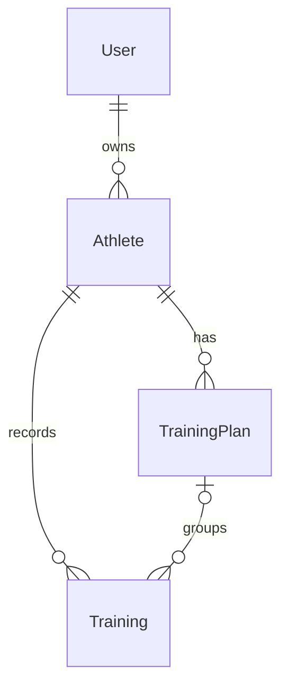

# Training Management API

一个基于 **FastAPI + PostgreSQL** 开发的运动训练数据管理后端项目。

项目用于管理用户、运动员、训练计划和训练记录，并实现了 JWT 身份认证、多用户数据隔离、数据库迁移、自动化测试和 Docker Compose 一键启动。

这个项目也是我学习 Python 后端开发、数据库、测试以及 AI 应用开发工程基础的实践项目。


## 1. 主要功能

- 用户注册与登录
- JWT Access Token 身份认证
- Bearer Token 权限验证
- 用户数据隔离
- Athlete 管理
- TrainingPlan 管理
- Training CRUD
- Training 分页查询
- Pydantic 请求参数校验
- PostgreSQL 数据持久化
- SQLAlchemy ORM
- Alembic 数据库迁移
- pytest API 自动化测试
- Docker 容器化
- Docker Compose 多服务管理
- PostgreSQL Healthcheck
- Docker 启动时自动执行数据库 Migration


## 2. 技术栈

| 技术 | 用途 |
| --- | --- |
| Python | 后端开发语言 |
| FastAPI | Web API 框架 |
| PostgreSQL | 关系型数据库 |
| SQLAlchemy | ORM 与数据库操作 |
| Pydantic | 数据校验与 Schema |
| Pydantic Settings | 环境变量配置 |
| Alembic | 数据库迁移 |
| PyJWT | JWT Token |
| pytest | 自动化测试 |
| Docker | 应用容器化 |
| Docker Compose | API、数据库等多容器管理 |


## 3. 项目结构

```text
FastAPI+SQL/
│
├── main.py
│   └── FastAPI 路由入口
│
├── database.py
│   └── SQLAlchemy Engine / Session
│
├── models.py
│   └── SQLAlchemy ORM Models
│
├── schemas.py
│   └── Pydantic 请求与响应模型
│
├── config.py
│   └── 环境变量与配置管理
│
├── security.py
│   └── 密码 Hash、密码验证、JWT 创建
│
├── auth.py
│   └── Token 解析与当前用户认证
│
├── permissions.py
│   └── 用户数据权限与资源所有权验证
│
├── logging_config.py
│   └── 日志配置
│
├── requirements.txt
│   └── Python 依赖
│
├── Dockerfile
│   └── FastAPI Image 构建配置
│
├── compose.yaml
│   └── Docker Compose 配置
│
├── .env
│   └── 本地私密环境变量，不提交 Git
│
├── .env.example
│   └── 环境变量模板
│
├── .gitignore
├── .dockerignore
│
├── docker/
│   └── init.sql
│       └── PostgreSQL 初始化脚本
│
├── alembic.ini
│
├── alembic/
│   ├── env.py
│   └── versions/
│       └── 数据库 Migration
│
└── tests/
    ├── conftest.py
    ├── test_auth.py
    ├── test_athletes.py
    ├── test_training_plans.py
    └── test_trainings.py


## 4. 数据关系

项目围绕用户、运动员、训练计划和训练记录组织数据。



| 关系 | 说明 |
| --- | --- |
| User → Athlete | 一个用户可以拥有多个运动员，每个运动员归属于一个用户 |
| Athlete → TrainingPlan | 一个运动员可以拥有多个训练计划 |
| Athlete → Training | 一个运动员可以拥有多条训练记录 |
| TrainingPlan → Training | 一个训练计划可以关联多条训练记录；训练记录的 `plan_id` 可为空 |

训练计划和训练记录通过所属运动员关联到用户。创建训练记录时，如果指定了训练计划，程序会检查该计划与训练记录是否属于同一个运动员。

## 5. 认证流程与数据权限

项目使用密码哈希和 JWT Access Token 实现用户认证。

1. 调用 `POST /users/register` 注册，提交 JSON 格式的用户名和密码；数据库保存密码哈希。
2. 调用 `POST /auth/login` 登录，以表单格式提交 `username` 和 `password`。
3. 认证成功后，接口返回 `access_token` 和 `token_type`。
4. 访问需要认证的接口时，在请求头中携带 Token：

   ```http
   Authorization: Bearer <access_token>
   ```

5. 后端验证 Token 的签名和有效期，读取当前用户，并在已接入权限校验的接口中检查资源归属。

可通过 `GET /users/me` 获取当前登录用户。Token 默认有效期为 30 分钟，可通过环境变量调整。

当前已在运动员列表、运动员详情、运动员创建，训练计划列表与创建，以及训练记录列表、详情、创建、局部更新和删除中接入认证及用户数据过滤或归属校验。受归属校验保护的资源不存在或不属于当前用户时，返回 `404`。

**当前权限覆盖范围尚未完整：** `GET /training-plans/{plan_id}`、`GET /athletes/{athlete_id}/trainings` 和 `PUT /trainings/{training_id}` 尚未接入当前用户认证及归属校验。

## 6. 环境变量配置

以下命令均在项目根目录执行，示例使用 PowerShell。

首次配置时，复制环境变量模板；已有 `.env` 时直接检查并补充配置：

```powershell
Copy-Item .env.example .env
```

下列配置适用于“本地运行 Python 应用，连接 Compose 中的 PostgreSQL”：

```dotenv
POSTGRES_USER=postgres
POSTGRES_PASSWORD=replace_with_your_database_password
POSTGRES_HOST=localhost
POSTGRES_PORT=5433
POSTGRES_DB=running_bd
TEST_POSTGRES_DB=running_test_db

SECRET_KEY=replace_with_a_random_secret_key
ALGORITHM=HS256
ACCESS_TOKEN_EXPIRE_MINUTES=30
```

| 变量 | 用途 |
| --- | --- |
| `POSTGRES_USER` | PostgreSQL 用户名；当前 Compose 的数据库服务使用 `postgres` |
| `POSTGRES_PASSWORD` | PostgreSQL 密码 |
| `POSTGRES_HOST` | 数据库主机名；本地连接使用 `localhost`，Compose 内部使用 `db` |
| `POSTGRES_PORT` | 数据库端口；当前宿主机映射端口为 `5433`，容器内部端口为 `5432` |
| `POSTGRES_DB` | 应用数据库名称；当前 Compose 使用 `running_bd` |
| `TEST_POSTGRES_DB` | 独立测试数据库名称；初始化脚本创建 `running_test_db` |
| `SECRET_KEY` | JWT 签名密钥 |
| `ALGORITHM` | JWT 签名算法，默认 `HS256` |
| `ACCESS_TOKEN_EXPIRE_MINUTES` | Access Token 有效期，单位为分钟 |

当前 `.env.example` 中的数据库名为 `running_db`、端口为 `5432`，且缺少 `TEST_POSTGRES_DB`。连接本项目 Compose 数据库时，应按上面的配置调整。`TEST_POSTGRES_DB` 是当前配置类的必填字段，即使暂不运行测试也需要填写。

通过 Compose 启动时，`api` 和 `migrate` 服务会覆盖数据库连接配置，使用 `db:5432` 和 `running_bd`。若连接自行安装的 PostgreSQL，则按实际主机、端口及数据库名称填写。

可使用 Python 生成随机签名密钥，并将结果填入 `SECRET_KEY`：

```powershell
python -c "import secrets; print(secrets.token_hex(32))"
```

`.env` 用于保存本地密码和密钥，不应提交到 Git；`.env.example` 用于共享配置字段，不应包含真实凭据。

## 7. 使用 Docker Compose 启动

准备好 Docker、Docker Compose 和 `.env` 后，执行：

```powershell
docker compose up --build -d
```

当前 Compose 包含三个服务：

| 服务 | 职责 |
| --- | --- |
| `db` | 运行 PostgreSQL 18，提供数据库和健康检查 |
| `migrate` | 等待数据库健康检查通过后，执行 `python -m alembic upgrade head` |
| `api` | 等待数据库就绪且迁移成功后，启动 FastAPI |

启动依赖顺序：

```text
PostgreSQL 健康检查通过
          ↓
Alembic 迁移成功完成
          ↓
FastAPI 启动
```

查看服务状态和日志：

```powershell
docker compose ps -a
docker compose logs migrate
docker compose logs -f api
```

`migrate` 是一次性任务，成功执行后退出属于正常状态。

API 服务地址为 `http://localhost:8000`，可使用 [Swagger UI](http://localhost:8000/docs) 或 [ReDoc](http://localhost:8000/redoc) 查看接口。

## 8. PostgreSQL 与 Volume 数据持久化

项目使用 PostgreSQL 保存用户、运动员、训练计划和训练记录。Compose 的端口映射为：

```text
宿主机 localhost:5433 → PostgreSQL 容器 5432
```

数据库使用命名 Volume `training-postgres-data`，挂载到容器中的 `/var/lib/postgresql`，用于持久化数据库文件。

| 操作 | 对数据库数据的影响 |
| --- | --- |
| `docker compose stop` | 停止容器，保留数据 |
| `docker compose down` | 移除容器和项目网络，保留命名 Volume |
| `docker compose up --build -d` | 重建应用镜像并启动服务，继续使用已有 Volume |
| `docker compose down -v` | 删除项目 Volume，清除其中的数据库数据 |

**仅在确定需要清空数据库时使用 `docker compose down -v`。**

`docker/init.sql` 挂载到 PostgreSQL 初始化目录，用于创建 `running_test_db`。该脚本仅在数据库数据目录首次初始化时执行；已有 Volume 不会因为重启容器而重新运行初始化脚本。

## 9. Alembic 数据库迁移

项目使用 Alembic 管理数据库结构变更。迁移文件位于 `alembic/versions/`，在线迁移使用项目的数据库连接配置。

本地开发时，可执行：

```powershell
# 查看当前数据库迁移版本
python -m alembic current

# 查看迁移历史
python -m alembic history

# 应用全部待执行迁移
python -m alembic upgrade head
```

修改 ORM 模型后，可生成迁移草稿：

```powershell
python -m alembic revision --autogenerate -m "describe_schema_change"
```

检查生成的迁移内容后，再执行 `upgrade head`。自动生成的迁移文件仍需人工确认，尤其是涉及删除、重命名或已有数据的变更。

Compose 启动流程已经通过 `migrate` 服务执行迁移。数据库服务运行时，也可以单独运行迁移任务：

```powershell
docker compose run --rm migrate
```

## 10. pytest 自动化测试

项目使用 pytest 和 FastAPI TestClient 测试 API，并通过独立 PostgreSQL 测试数据库隔离测试数据。

| 测试文件 | 已编写的主要测试内容 |
| --- | --- |
| `tests/test_auth.py` | 注册、重复用户名、登录、错误密码、当前用户查询及部分跨用户访问校验 |
| `tests/test_athletes.py` | 创建运动员需要登录、训练记录关联不存在的运动员 |
| `tests/test_training_plans.py` | 运动员不存在、训练计划与运动员不匹配 |
| `tests/test_trainings.py` | 训练记录创建、查询、局部更新、删除、参数校验、计划关联、分页参数与排序 |

运行前，确认 `TEST_POSTGRES_DB=running_test_db`，且测试数据库已经存在。测试与应用数据库共用主机、端口和用户配置。

**测试夹具会删除并重建测试数据库中的项目表。必须使用独立测试数据库，不能指向需要保留数据的数据库。** 当前测试夹具会检查测试数据库名称与应用数据库名称不同。

本地安装依赖并配置好数据库连接后，运行：

```powershell
python -m pytest
```

也可以在已启动的 API 容器中运行：

```powershell
docker compose exec api python -m pytest
```

如果使用已有 Volume，而测试数据库尚未创建，可执行一次：

```powershell
docker compose exec db psql -U postgres -d postgres -c "CREATE DATABASE running_test_db;"
```

## 11. 本地运行

本地开发可采用“PostgreSQL 在 Docker 中运行，FastAPI 在本地运行”的方式。

### 11.1 创建虚拟环境并安装依赖

当前 Docker 镜像使用 Python 3.14，本地环境可采用相同版本。

```powershell
python -m venv .venv
.\.venv\Scripts\Activate.ps1
python -m pip install -r requirements.txt
```

### 11.2 配置并启动数据库

按第 6 节准备 `.env`，本地连接 Compose 数据库时使用 `localhost:5433`，应用数据库名为 `running_bd`。

```powershell
docker compose up -d db
docker compose ps
```

等待数据库健康检查通过，再执行迁移。

### 11.3 执行迁移并启动 API

```powershell
python -m alembic upgrade head
python -m uvicorn main:app --reload
```

启动后访问 [Swagger UI](http://localhost:8000/docs)。先注册用户，再通过页面中的 **Authorize** 使用用户名和密码登录，之后调用受保护的接口。

若此前已通过 Compose 启动 `api`，先执行 `docker compose stop api`，释放本地 `8000` 端口。

## 12. 常用 Docker 命令

| 命令 | 用途 |
| --- | --- |
| `docker compose up --build -d` | 构建镜像并在后台启动项目 |
| `docker compose up -d db` | 只启动数据库 |
| `docker compose ps -a` | 查看所有服务容器状态，包括已退出的迁移任务 |
| `docker compose logs -f api` | 持续查看 API 日志 |
| `docker compose logs db` | 查看数据库日志 |
| `docker compose logs migrate` | 查看迁移日志 |
| `docker compose restart api` | 重启 API 容器 |
| `docker compose exec db psql -U postgres -d running_bd` | 进入应用数据库交互终端 |
| `docker compose exec api python -m pytest` | 在 API 容器中运行测试 |
| `docker compose stop` | 停止服务，保留容器和数据 |
| `docker compose down` | 移除容器和项目网络，保留命名 Volume |
| `docker volume inspect training-postgres-data` | 查看数据库 Volume 信息 |

当前 Compose 没有将本地源代码挂载到 API 容器。修改代码后，应重新执行 `docker compose up --build -d`；仅重启容器不会更新镜像中的代码。

## 13. HTTP 状态码

| 状态码 | 当前项目中的典型含义 |
| --- | --- |
| `200 OK` | 登录、查询、更新或删除成功；当前训练记录删除接口返回 JSON 消息 |
| `201 Created` | 用户、运动员、训练计划或训练记录创建成功 |
| `400 Bad Request` | 用户名重复、训练计划与运动员不匹配，或已处理的数据库约束错误等 |
| `401 Unauthorized` | 登录凭据错误，或受保护接口缺少有效 Token、Token 无效或过期 |
| `404 Not Found` | 资源不存在；在已接入归属校验的接口中，也用于不可访问的其他用户资源 |
| `422 Unprocessable Entity` | 请求参数未通过校验，例如距离非正数、RPE 超出范围或分页参数无效 |

## 14. 当前能力

- 用户注册、密码哈希、登录和 JWT 身份认证。
- 当前用户查询，以及第 5 节所列接口中的用户数据隔离。
- 运动员创建、列表查询与详情查询。
- 训练计划创建、列表查询与详情查询。
- 训练记录增删改查，以及训练记录与运动员、训练计划的关联。
- 训练记录分页查询：`page` 默认 `1`，`page_size` 默认 `10`、最大 `100`，按日期及 ID 降序排列。
- 使用 Pydantic 校验请求参数，使用 SQLAlchemy 操作 PostgreSQL。
- 使用 Alembic 管理数据库迁移。
- 已编写 pytest API 测试，并配置独立测试数据库。
- 使用 Docker Compose 编排数据库、迁移任务和 API，通过健康检查与迁移结果控制启动顺序。
- 使用命名 Volume 持久化数据库数据。

当前项目处于后端工程实践阶段；权限校验的覆盖范围见第 5 节。

## 15. 后续计划：LLM / RAG / Agent

以下内容均为后续探索方向，尚未实现：

- **LLM**：探索基于训练记录生成自然语言总结、解释与问答。
- **RAG**：探索引入训练相关资料，通过检索为回答补充参考依据。
- **Agent**：探索由智能体调用已有后端接口，完成训练数据查询、整理等多步骤任务。

后续开发以现有 API、数据库和认证机制为基础，逐步验证各项能力。

## 16. 项目目标

以运动训练数据管理为实践场景，建立从 API 设计、关系型数据库建模、身份认证和数据权限，到迁移、测试与容器化运行的完整后端开发流程。

在此基础上，逐步学习和实践 LLM、RAG 与 Agent 应用开发，为后续构建能够使用真实业务数据和工具的 AI 应用打下工程基础。
